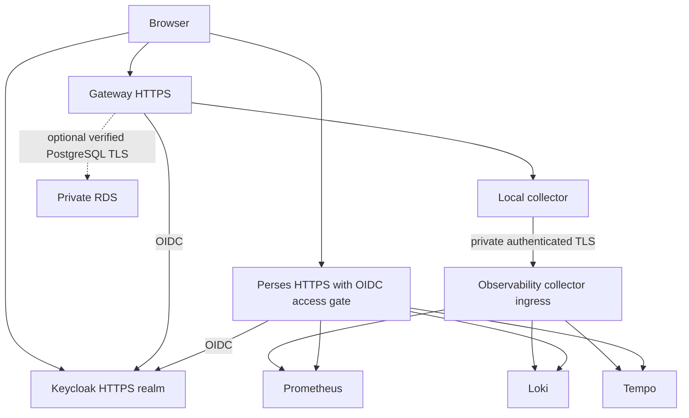

# Three-VM lab design and acceptance

Start with [node and collector ownership](topology.md). The [gateway OIDC input contract](oidc.md) describes protected configuration; [security acceptance](security-acceptance.md) separates verified local behavior from pending AWS/RHEL checks.

## Existing work and ownership

The [local Podman fixture](local-podman.md) qualifies the external services in one pod. The [RHEL Keycloak installer](keycloak-rhel.md) is implemented but not runtime-qualified; the [RHEL observation-host installer](observability-rhel.md) is also implemented with generator/configuration checks, while full runtime integration remains unfinished. Reuse [Mini #11](https://github.com/redhat-et/enmaas-mini/issues/11) for auxiliary hosts, [#13](https://github.com/redhat-et/enmaas-mini/issues/13) for Keycloak, [#18](https://github.com/redhat-et/enmaas-mini/issues/18) for OIDC integration, [#32](https://github.com/redhat-et/enmaas-mini/issues/32) for observability, and [#12](https://github.com/redhat-et/enmaas-mini/issues/12) for RDS. This draft does not close them.

| Host | Services | Responsibility |
| --- | --- | --- |
| Gateway | Praxis, PriceTag Metering, MaaS, local DB initially; collector agent | Inference/auth/budgets; emit sanitized operational telemetry. Mock backends and traffic generation only during benchmarking. |
| Observability | Perses, Prometheus, Loki, Tempo, collector, authenticated ingress | Metrics, logs and traces are separate stores. Perses displays/query-proxies them; it is not a storage backend. |
| Identity | Production-mode Keycloak, private PostgreSQL, restricted HTTPS ingress | One realm, separate clients and service-owned sessions. No development-mode Keycloak or public database. |
| Optional RDS | Private encrypted PostgreSQL | Separate gateway databases/roles. Keycloak keeps its own private database initially to reduce shared failure scope. |

## TLS, networks and secret custody

**First test uses private CA and VM IP addresses.** Generate a lab-specific CA on the operator workstation, protect its private key there, and issue separate service certificates with the exact public/private IP SANs needed. Copy only the CA certificate and each service's own key/certificate to its host. Install CA trust in browser/OS and all relevant runtimes, including Keycloak, OIDC clients and collector. No `insecure_skip_verify`, browser-exception dependency or shared leaf private key.

Use one stable issuer URL, exact callbacks and exact logout destinations. Prefer canonical DNS later; IP changes require coordinated certificate and OIDC registration updates. A private backchannel must preserve the configured issuer identity and verify the target certificate; do not substitute a different issuer merely to use a private IP.

| Traffic | Allowed source | Boundary |
| --- | --- | --- |
| SSH 22 | Administrator `/32` | No AWS administrator credentials on VMs. |
| Browser HTTPS 8443 | Administrator `/32` initially | Application authentication remains required. |
| OIDC backchannel | Gateway and observability identities | HTTPS with verified CA/hostname; exact endpoints. |
| Telemetry ingestion | Gateway only | Private interface, authenticated TLS; separate machine identity from browser OIDC. |
| Backend query ports | Perses/query proxy and collector locally | Not published to the host/VPC/browser. |
| PostgreSQL 5432 | Authorized application security group | Private RDS only; verified server TLS and separate least-privilege roles. |

Use security-group references and narrow host firewall rules for private inter-VM paths. For a canonical issuer using the Keycloak public IP, allow HTTPS from the exact gateway/observability public `/32` addresses unless the pinned clients support a verified private backchannel while preserving issuer validation. Security-group references do not authorize traffic traversing public IPs. Track address changes explicitly; do not open the issuer to all IPs to work around this. Never trust client-supplied tenant or identity headers. Strip/overwrite them at the trusted ingress. Fix one lab tenant server-side. Queue/export errors must not block inference; cap memory/disk queues and retry with backoff.

## Shared SSO and superadmin access

One Keycloak login can serve both applications using **separate OIDC clients**, secrets, callbacks and cookies. It does not mean shared application sessions or automatic global logout.

- PriceTag requires its stable UUID identity mapping (currently `rhatUUID`) and an active partner record. Create matching identities through its supported management API; do not insert users directly into the database.
- Configure a dedicated Keycloak observability role/group for the test superadmin. PriceTag roles and Keycloak groups are separate authorities: explicitly assign both and test revocation. Do not grant observability access to every successful OIDC login or ordinary team manager.
- The tested implementation uses pinned OAuth2 Proxy with an explicit observability-group allowlist. Perses has no separate login and is reachable only through that proxy; its direct port and backend ports are not published. This is one administrator-only observation service, not per-user or per-team telemetry isolation.
- Require anonymous rejection, Bob/team-manager denial, superadmin access, wrong issuer/audience denial, CSRF/origin protection and bounded authorization revocation. Define session/refresh lifetimes and test role removal with an existing session.
- Do not forward browser tokens to telemetry stores or use an inference key as a collector credential. Keycloak administration is distinct from realm login: protect admin routes separately, not merely with a different hostname.

Sources: [PriceTag OIDC contract](https://github.com/redhat-et/pricetag-metering/blob/15d85fe2130869a1bf6ce219a86f908b94606ae0/docs/oidc-rollout.md), [Keycloak production configuration](https://www.keycloak.org/server/configuration-production), [reverse-proxy boundaries](https://www.keycloak.org/server/reverseproxy), [OAuth2 Proxy Keycloak authorization](https://oauth2-proxy.github.io/oauth2-proxy/configuration/providers/keycloak_oidc/). Loki/Tempo tenant headers are not authentication; see [Tempo authentication](https://grafana.com/docs/tempo/latest/operations/authentication/).

## Dashboard and telemetry contract

Native Perses resources are imported under `tests/external-services/perses` with a source revision and hashes. Experimental also has Grafana JSON; that is not interchangeable with Perses. Keep the original repository intact until downstream users agree a removal; this PR establishes Mini's copy and provenance.

- Qualify the gateway overview, filter latency and Tempo trace views against the pinned Praxis metrics/spans and Perses plugins.
- The token-budget dashboard uses `token_rate_limit` metrics. **Do not enable that filter just to populate it:** Mini uses Metering USD control. Keep the imported dashboard as reference, adapt/replace its panels with actual Metering USD/denial metrics, and label unsupported panels explicitly.
- Audit the overview too: counts should come from unsampled counters, not sampled spans. Do not label every 429 as USD exhaustion.
- Add host CPU, available memory, disk growth, collector backlog/drop rate and backend storage panels. Keep Loki log exploration behind the same authorization gate; confirm the selected Perses log plugin/API rather than promise parity with Grafana.
- Never collect prompts, completions, keys, Authorization/cookies, raw query strings or sensitive user identifiers by default. Use bounded service/model/error labels; prove filtering with seeded sentinel values.
- PriceTag metrics are available upstream; tracing integration remains dependent on the selected upstream revision. Missing spans must be documented, not filled with synthetic evidence.

All images need immutable digests, provenance, architecture/plugin compatibility and license inventory. Local-filesystem stores are suitable for this short-retention test, not an HA claim. Start with a proposed 24-hour logs/traces and 48-hour metrics retention, plus enforced disk caps; validate the actual backend retention mechanism and deletion behavior.

## Benchmark observation plan

`tests/external-services/traffic-patterns.json` defines six target 10-minute phases: baseline, 20 users, parallel requests per user, 30-second bursts, explicit rate limiting, recovery. The [scenario command](benchmark.md) connects the tested deadline scheduler and verified HTTPS transport to the existing mock guard, RHEL resource observer, identity APIs and ledger verifier. Failure cleanup is unit-tested, including partial provisioning and failed restoration. The local runner has passed a short six-phase execution with independent event/token/USD reconciliation and cleanup. **Sustained and RHEL acceptance remain pending:** this is not a capacity or deployment qualification. Existing `capacity` retains its request-count cap; the new command uses deadlines instead.

For every phase record wall-clock start/end, users, streams, offered/completed rate, 429 source, errors, TTFT/latency, CPU/RAM/disk, DB/report lag, telemetry delay/drops and accounting reconciliation. Put phase markers in an observation timeline with a bounded run ID. Sampling rate must be fixed and reported.

Run only against mocked LLMs, high USD test budgets and intentionally configured transport limits; USD-blocking is a separate tagged test. Restore limits and suspend/revoke test identities on interruption or failure. Abort on memory/disk guardrails, service restarts, unexpected errors or accounting mismatch. Keep collector/backend failure experiments separate from the main performance comparison. A generator on the gateway consumes its resources; report that explicitly, and use a workstation/separate generator for a clean follow-up measurement.

## Optional RDS and acceptance gates

Use a small configurable encrypted **non-public Single-AZ** RDS PostgreSQL test instance, a DB subnet group across at least two AZs, restrictive security-group references and supported engine version. Single-AZ is not HA. Reuse external-DB connection support; keep master/bootstrap credentials out of containers and command lines. AWS creates infrastructure on the workstation; a protected database provisioning step creates service roles/databases and schema permissions. The [RDS planner](rds.md) supports read-only validation and explicitly confirmed creation with a recovery journal. No RDS resource has been created during local qualification.

Before calling the lab ready:

1. Fresh install/reboot succeeds on all three VMs with private CA validation and no public backend ports.
2. Real OIDC browser tests prove same-realm login, correct UUID/role mapping and denied non-admin observability access, including existing-session revocation behavior.
3. Authenticated machine ingestion works; spoofed tenants, untrusted certificates and direct backend access fail.
4. Metrics/logs/traces and imported dashboard queries are verified against actual signals; secrets/sentinel content are absent.
5. Six measured traffic phases complete with resource graphs and accounting evidence; retention and telemetry outage behavior are verified.
6. Optional RDS receives a separate migration/reconnect/recovery test and a reviewed cleanup inventory.
