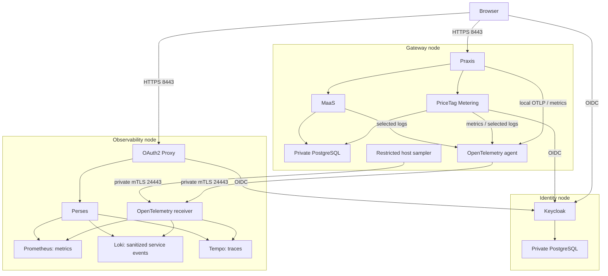

# Nodes and telemetry flow

## Deployment layout

| Node | Components | Responsibility |
| --- | --- | --- |
| Gateway | Praxis, PriceTag Metering, MaaS, local PostgreSQL (or external databases), OpenTelemetry agent, host sampler | Serve inference and dashboards; authenticate users; enforce budgets and record usage; collect local operational telemetry. |
| Identity | Keycloak and its private PostgreSQL | Authenticate browser users. Separate OIDC clients and sessions serve PriceTag Metering and observability. |
| Observability | OpenTelemetry receiver, Prometheus, Loki, Tempo, Perses, OAuth2 Proxy | Receive authenticated telemetry, store it and provide administrator-only dashboards. |
| Optional RDS | Private PostgreSQL with separate service databases and roles | Store gateway application data. It does not replace the telemetry stores or Keycloak database in this lab. |

## Why there are two collectors

**The gateway agent** has local access to private metrics endpoints, Praxis OTLP and explicitly selected container log files. It removes unsupported attributes and original log text before export. It runs rootless with bounded memory/retries; it exposes no host port. Remote telemetry failure must not become an inference dependency.

**The observability receiver** accepts authenticated OTLP on the observation node, applies its own transforms and exports to the private stores. It must run on this node even when the gateway agent is present. It neither needs the gateway's filesystem nor a Podman socket.

The restricted **host sampler** is separate: it reads aggregate Linux CPU/memory/filesystem values and sends them directly over mTLS. It does not collect process arguments or environment variables.

**Accounting is separate from observability.** PriceTag Metering records usage and USD charges in PostgreSQL through its application path. Losing a sampled trace or dropping a telemetry batch does not remove an accounting record. Neither traces nor request-rate graphs replace ledger reconciliation.

## Local versus AWS

The local fixture runs these components in one Podman pod with loopback-only published TLS ports. Its separate agent/receiver still exercises mTLS and signal processing. Shared networking, a disposable shared database server/role and fixture certificates simplify the test; they do **not** reproduce the three-host trust boundary.

**Browser shortcut:** the local applications share `localhost` on different ports. Browser cookies are scoped by host/path, not port, so this is not evidence of cookie isolation between separate nodes. The RHEL setup uses distinct host addresses and application cookie settings; qualify that boundary there.

**Database shortcut:** the local application fixture uses its test PostgreSQL bootstrap role for Keycloak, MaaS and PriceTag databases. This role has broader privileges than the RHEL application roles. Do not attach real providers or production identity data to this shared fixture; it does not qualify database least privilege. The isolated database-role test checks the intended role contract separately.

**Container privileges:** rootless describes the host mapping, not the UID inside every container. The synthetic provider uses container UID 0 inside that rootless mapping; application services use their image users. Service containers drop capabilities, set `no-new-privileges` and have memory limits. Not every local service has a read-only root filesystem. The Podman infrastructure container is separate from these service limits. Inspect the actual RHEL units and runtime rather than inferring those properties from this fixture.

The RHEL installers use separate hosts, role-specific certificates, separate gateway/Keycloak databases and private telemetry routing. See [security acceptance](security-acceptance.md) for the evidence needed before qualifying that deployment.

## Implementation map

- [Script index](../../../tests/external-services/README.md): entry points by operation and node.
- [Gateway agent](gateway-telemetry.md), [observability host](observability-rhel.md), [identity host](keycloak-rhel.md).
- [Detailed design](design.md): trust boundaries, identity contracts and acceptance requirements.
